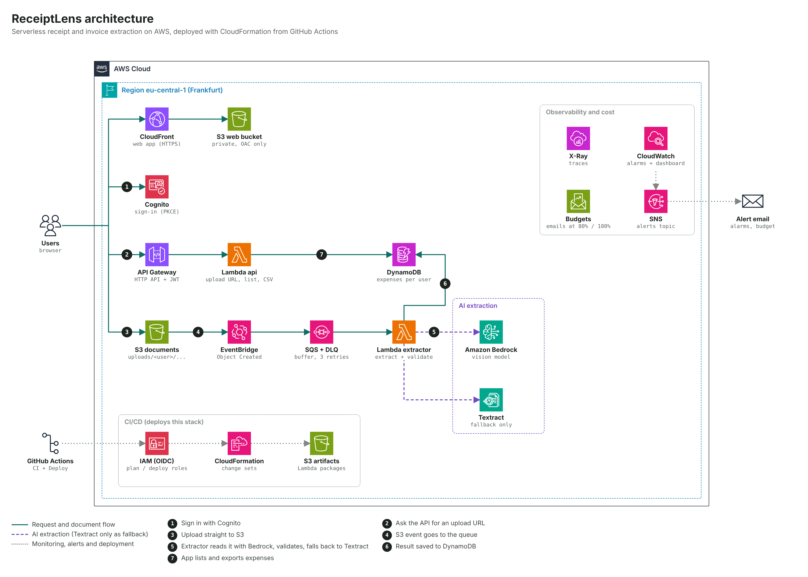

# ReceiptLens

Turn a photo or PDF of a receipt or invoice into validated expense data, on a serverless, event-driven AWS pipeline that costs a few cents a month at demo volume.

**Problem.** Small businesses, freelancers and accountants still retype receipts by hand. Off-the-shelf extraction (Textract AnalyzeExpense) costs $10 per 1,000 pages, and Romanian is not among Textract's announced OCR languages.

**Solution.** A Bedrock vision model reads the document and returns strict JSON. Business rules check the totals, VAT and dates. Only documents that fail validation fall back to Textract.

**Docs:** this README covers the architecture and the one-time setup. Day-to-day use (shipping changes, users, monitoring, rollback, teardown, demo checklist) is in [docs/DEPLOYMENT.md](docs/DEPLOYMENT.md).

## Architecture



Numbered steps: (1) sign in with Cognito, (2) ask the API for an upload URL, (3) upload straight to S3, (4) the S3 event goes to the queue, (5) the extractor reads the document with Bedrock, validates it and falls back to Textract only if needed, (6) the result is saved to DynamoDB, (7) the app lists and exports expenses.

The editable source is [`docs/architecture.drawio`](docs/architecture.drawio): open it in [diagrams.net](https://app.diagrams.net) or the VS Code Draw.io extension. The icons come from the official AWS Architecture Icons package.

| Service | Why it's here |
| --- | --- |
| Amazon Cognito (Lite) | Sign-in; the user's `sub` is the tenant ID, so isolation comes from the verified token |
| CloudFront + S3 | Static web app; bucket is private and reachable only through Origin Access Control |
| API Gateway HTTP API | JWT authorizer, throttling, access logs; $1 per million requests vs $3.50 for REST |
| S3 | Browser uploads directly via presigned POST, so files never pass through Lambda |
| EventBridge | Filters `Object Created` events to the `uploads/` prefix |
| SQS + DLQ | Absorbs bursts; caps concurrency so Bedrock quotas are never hit; poison files land in the DLQ |
| Lambda (Python 3.13, arm64) | Extraction, validation, API |
| Amazon Bedrock | Multimodal model reads the image; tool use forces schema-shaped JSON |
| Amazon Textract | Fallback only, when validation fails |
| DynamoDB | `tenant_id` + `doc_id`, on-demand, point-in-time recovery |
| CloudWatch, X-Ray, SNS | Metrics, alarms, dashboard, tracing, email alerts |
| AWS Budgets | Cost guardrail |

## Repository layout

```
bootstrap/bootstrap.yaml  One-time stack: GitHub OIDC provider, plan + deploy roles,
                          CloudFormation execution role, artifacts bucket
infra/template.yaml       All application infrastructure (CloudFormation)
app/extractor/            SQS-triggered extraction Lambda
app/api/                  HTTP API Lambda
web/                      Static web client (no build step)
scripts/changeset.sh      Package code, create / execute / delete change sets
scripts/publish-web.sh    Upload the web app with config.js built from stack outputs
tests/                    pytest unit tests
.github/workflows/        CI (lint, tests, cfn-lint, Checkov) and Deploy (change set on PR, execute on main)
.github/dependabot.yml    Weekly updates for GitHub Actions versions
docs/DEPLOYMENT.md        How to use and operate the deployment
docs/architecture.*       Architecture diagram (PNG for the README, .drawio to edit)
.checkov.yaml             Accepted security findings, each with its reason
```

## CI/CD and security model

- **No AWS keys in GitHub.** Actions authenticates with OIDC and assumes a short-lived IAM role.
- **Three roles, least privilege.**
  - `receiptlens-github-plan` is read-only and can also *create* change sets. Pull requests and `main` can assume it.
  - `receiptlens-github-deploy` can only *execute* change sets and publish the web bucket. Only jobs in the `prod` GitHub environment can assume it, and that environment requires a manual approval.
  - `receiptlens-cfn-execution` is the role CloudFormation itself uses to create resources. The GitHub roles can only pass it to CloudFormation and never hold these broad permissions themselves.
- **Review, then execute exactly that.**
  - Every pull request gets a comment listing the resources the change set would add, modify or replace. The change set is deleted afterwards.
  - On `main`, the same kind of change set is created and shown in the job summary. After approval, the deploy job executes exactly that change set.
- **No state bucket.** CloudFormation keeps the state of the stack itself, so there is no state file to store, lock or lose.
- **Browser sessions.**
  - Tokens are kept in memory only, never in browser storage.
  - **Sign in** always shows the Cognito password form, because any earlier hosted-UI session is ended first.
  - A refresh, a new tab or 15 minutes without activity signs the user out.
  - The API rejects any request without a valid token (`401`), whatever the page shows.
- **Checks on every change.** cfn-lint and shellcheck lint the templates and scripts. Checkov fails the build on any finding not listed in `.checkov.yaml`, and every listed skip states its reason.
- **Reproducible runners.**
  - Jobs run on a pinned `ubuntu-24.04` image, not `ubuntu-latest`, so a runner OS migration can't change builds unannounced. Moving to `ubuntu-26.04` is a deliberate one-line PR.
  - Actions use their Node 24 major versions (`checkout@v7`, `setup-python@v7`, `configure-aws-credentials@v6`), and Dependabot proposes updates weekly.
  - PR comments use the preinstalled `gh` CLI instead of a third-party action.

## First deployment

### Why a bootstrap step?
GitHub can only log in to AWS through OIDC once the OIDC provider and the IAM roles exist. Creating them requires AWS access, which is exactly what they provide. So a human with admin rights deploys `bootstrap/bootstrap.yaml` **once**, and every deploy after that goes through OIDC with no long-lived keys.

### 0. Prerequisites
- An AWS account on the **Paid plan**, so it doesn't close after 6 months, with MFA on root and an admin user (IAM Identity Center).
- In the Bedrock console for your region, open the model catalog and confirm **Amazon Nova Lite** is available. Using a different model? See *Changing the model* below.

### 1. Bootstrap, once, from AWS CloudShell
Open CloudShell in the console, **in the same region as the app (eu-central-1)**. It is already signed in as you, so you need no keys on your laptop. Upload `bootstrap/bootstrap.yaml` or clone the repo, then run:
```bash
aws cloudformation deploy --region eu-central-1 \
  --stack-name receiptlens-bootstrap \
  --template-file bootstrap/bootstrap.yaml \
  --capabilities CAPABILITY_NAMED_IAM \
  --parameter-overrides GitHubOwner=<your-github-user> GitHubRepo=<repo-name>

aws cloudformation describe-stacks --stack-name receiptlens-bootstrap \
  --query 'Stacks[0].Outputs[].[OutputKey,OutputValue]' --output table
```
`GitHubOwner` and `GitHubRepo` must match GitHub exactly, including capitalisation: the role trust check is case-sensitive.

Always pass `--region eu-central-1` (the app region), even if your CLI's default region is different. The artifacts bucket and the roles' CloudFormation permissions belong to the region where the bootstrap is deployed, and Lambda can only load code from a bucket in its own region.

#### If GitHub sends the OIDC subject with numeric IDs
Some accounts send the token's `sub` with immutable IDs, in the form `repo:<owner>@<owner-id>/<repo>@<repo-id>:ref:refs/heads/main`, instead of `repo:<owner>/<repo>:ref:refs/heads/main`. The first pipeline run then fails with `Not authorized to perform sts:AssumeRoleWithWebIdentity`. To fix it:

```bash
# 1. See the exact sub GitHub sent (the region where the pipeline runs)
aws cloudtrail lookup-events --region eu-central-1 \
  --lookup-attributes AttributeKey=EventName,AttributeValue=AssumeRoleWithWebIdentity \
  --max-results 5 --query 'Events[].CloudTrailEvent' --output text \
  | jq -c '{time: .eventTime, error: .errorCode, sub: .userIdentity.userName}'
#    → repo:alice@1234567/ReceiptLens@98765432:ref:refs/heads/main

# 2. Redeploy the bootstrap with everything BEFORE ":ref:" as the prefix
aws cloudformation deploy --region eu-central-1 --stack-name receiptlens-bootstrap \
  --template-file bootstrap/bootstrap.yaml --capabilities CAPABILITY_NAMED_IAM \
  --parameter-overrides GitHubOwner=alice GitHubRepo=ReceiptLens \
    GitHubSubjectPrefix='repo:alice@1234567/ReceiptLens@98765432'
```

The template appends `:pull_request` and `:ref:refs/heads/main` for the plan role, and `:environment:prod` for the deploy role. CloudTrail can take a few minutes to show new events.

You can also deploy the same file from the CloudFormation console with **Create stack → Upload a template file**.

#### If the account already has a GitHub OIDC provider
An AWS account can hold only one OIDC provider per URL. If an earlier project already created one for GitHub, the deploy fails with:

```
Failed to create the changeset ... [AWS::EarlyValidation::ResourceExistenceCheck]
```

Nothing has been created at that point. Reuse the existing provider instead:

```bash
# 1. Confirm it exists and copy its ARN
aws iam list-open-id-connect-providers
#    → arn:aws:iam::<account-id>:oidc-provider/token.actions.githubusercontent.com

# 2. Deploy again, passing that ARN
aws cloudformation deploy --region eu-central-1 \
  --stack-name receiptlens-bootstrap \
  --template-file bootstrap/bootstrap.yaml \
  --capabilities CAPABILITY_NAMED_IAM \
  --parameter-overrides GitHubOwner=<your-github-user> GitHubRepo=<repo-name> \
    ExistingOidcProviderArn=arn:aws:iam::<account-id>:oidc-provider/token.actions.githubusercontent.com
```

The failed attempt leaves the stack in `REVIEW_IN_PROGRESS`. That is harmless, and the second `deploy` reuses it. The shared provider stays outside this stack, so deleting `receiptlens-bootstrap` later won't break your other projects.

Before reusing the provider, check that its audience includes `sts.amazonaws.com`:

```bash
aws iam get-open-id-connect-provider \
  --open-id-connect-provider-arn arn:aws:iam::<account-id>:oidc-provider/token.actions.githubusercontent.com
```

Look for `sts.amazonaws.com` under `ClientIDList`. If it's missing, add it:

```bash
aws iam add-client-id-to-open-id-connect-provider \
  --open-id-connect-provider-arn <arn> --client-id sts.amazonaws.com
```

### 2. Configure the GitHub repository
Read the bootstrap outputs, from CloudShell or **CloudFormation → receiptlens-bootstrap → Outputs**:
```bash
aws cloudformation describe-stacks --stack-name receiptlens-bootstrap \
  --query 'Stacks[0].Outputs[].[OutputKey,OutputValue]' --output table
```

In the repo, under **Settings → Secrets and variables → Actions**:

| Type | Name | Value |
| --- | --- | --- |
| Variable | `AWS_REGION` | `eu-central-1` |
| Variable | `AWS_PLAN_ROLE_ARN` | `PlanRoleArn` output |
| Variable | `AWS_DEPLOY_ROLE_ARN` | `DeployRoleArn` output |
| Variable | `CFN_EXECUTION_ROLE_ARN` | `CloudFormationExecutionRoleArn` output |
| Variable | `ARTIFACTS_BUCKET` | `ArtifactsBucket` output |
| Secret | `ALERT_EMAIL` | where alarms and budget alerts go |

The role ARNs are not sensitive: only this repo can assume the roles, because of the OIDC trust policy. The email is a secret to keep it out of public logs.

**Or with the GitHub CLI**, using `gh auth login` first:
```bash
REPO=<owner>/<repo>
out() { aws cloudformation describe-stacks --stack-name receiptlens-bootstrap \
  --query "Stacks[0].Outputs[?OutputKey=='$1'].OutputValue" --output text; }
gh variable set AWS_REGION             -R $REPO -b eu-central-1
gh variable set AWS_PLAN_ROLE_ARN      -R $REPO -b "$(out PlanRoleArn)"
gh variable set AWS_DEPLOY_ROLE_ARN    -R $REPO -b "$(out DeployRoleArn)"
gh variable set CFN_EXECUTION_ROLE_ARN -R $REPO -b "$(out CloudFormationExecutionRoleArn)"
gh variable set ARTIFACTS_BUCKET       -R $REPO -b "$(out ArtifactsBucket)"
gh secret set   ALERT_EMAIL            -R $REPO
```

**The `prod` environment** (manual approval before every deploy):
1. **Settings → Environments → New environment**. Name it exactly `prod`.
2. Tick **Required reviewers** and add yourself.
3. Under **Deployment branches and tags**, choose **Selected branches and tags** and add `main`.
4. Optionally, untick **Allow administrators to bypass**.

Required reviewers on a *private* repo need GitHub Pro, Team or Enterprise. On the free plan, make the repo public. There are no secrets in the code.

**Protect `main`**, after the first run, so the check names exist and you can select them:
1. **Settings → Rules → Rulesets → New branch ruleset**, target the default branch, enforcement **Active**.
2. Enable **Restrict deletions** and **Block force pushes**.
3. Enable **Require a pull request before merging** with **Required approvals = 0**. GitHub does not let you approve your own PR, so with 1 a solo maintainer is locked out.
4. Enable **Require status checks to pass** and add:
   - `Lint and test (Python)`
   - `Lint CloudFormation and scripts`
   - `IaC security scan (Checkov)`
   - `Create change set`

### 3. Deploy
Push the code, for example from the repo folder:
```bash
git init -b main
git add .
git update-index --chmod=+x scripts/*.sh   # keep the executable bit when committing from Windows
git commit -m "Initial commit"
git remote add origin https://github.com/<owner>/<repo>.git
git push -u origin main
```

The first push needs a GitHub credential that can write workflow files. Use one of these:
- **Git Credential Manager**: a browser sign-in. It is the default with Git for Windows.
- **A classic personal access token** with the `repo` **and** `workflow` scopes.
- **A fine-grained token** for this repo only, with these permissions set to *Read and write*: Contents, Workflows, Variables, Secrets.

Then in the **Actions** tab:
1. **CI** runs ruff, pytest, cfn-lint, shellcheck and Checkov.
2. **Deploy → Create change set** packages the Lambdas and creates the change set. The run **Summary** shows the resources it will add, modify or replace.
3. **Deploy → Execute change set (prod)** waits at **Waiting for review**. Click **Review deployments → Approve and deploy**.

The first deploy takes about 5–10 minutes, most of it creating the CloudFront distribution. You can follow it in **CloudFormation → receiptlens-prod → Events**. When it finishes:

1. Confirm the SNS subscription email (*AWS Notification – Subscription Confirmation*). Without it, alarms won't reach you.
2. Create your user:
   ```bash
   POOL=$(aws cloudformation describe-stacks --stack-name receiptlens-prod \
     --query "Stacks[0].Outputs[?OutputKey=='UserPoolId'].OutputValue" --output text)
   aws cognito-idp admin-create-user --user-pool-id $POOL \
     --username you@example.com \
     --user-attributes Name=email,Value=you@example.com Name=email_verified,Value=true
   ```
3. Open `WebUrl` from the job output, sign in with the temporary password from the email, set a new one, and upload a receipt.

From then on, every change goes: branch → PR (CI and a change set comment) → merge → approve the deploy.

## Local development

```bash
python -m venv .venv && source .venv/bin/activate
pip install pytest ruff boto3 cfn-lint checkov
ruff check app tests
pytest -q
cfn-lint
checkov -d infra -d bootstrap --config-file .checkov.yaml --compact
```

## Troubleshooting

Problems hit during real deployments of this project, in the order they tend to appear.

| Symptom | Cause | Fix |
| --- | --- | --- |
| Bootstrap: `Failed to create the changeset ... [AWS::EarlyValidation::ResourceExistenceCheck]` | A resource with the same name already exists. Usually the GitHub OIDC provider, which the account can hold only once. | Pass `ExistingOidcProviderArn=...` (see *If the account already has a GitHub OIDC provider*). The stack stays in `REVIEW_IN_PROGRESS` meanwhile, which is harmless. |
| Pipeline: `Could not assume role with OIDC: Not authorized to perform sts:AssumeRoleWithWebIdentity` | The token from GitHub doesn't match the role's trust policy. | Work through the checks below. |
| Create change set: `not authorized to perform: cloudformation:CreateChangeSet on resource: ...:stack/receiptlens-prod/*` (or the pipeline says *Bootstrap is in us-east-1 but the pipeline deploys to eu-central-1*) | The bootstrap was deployed in the CLI's default region instead of `eu-central-1`, so the role permissions and the artifacts bucket are in the wrong region. | Empty the artifacts bucket (including object versions), delete the `receiptlens-bootstrap` stack in the wrong region, and redeploy it with `--region eu-central-1`. Role and bucket names stay the same, so the GitHub variables don't change. |
| Pipeline: `scripts/changeset.sh: Permission denied` (exit 126) | The repo was committed from Windows, so the scripts lost their executable bit. | The workflow calls scripts through `bash`, so this is already handled. Also run `git update-index --chmod=+x scripts/*.sh` and commit. |
| `git push` rejected: *refusing to allow a Personal Access Token to create or update workflow* | The token lacks the `workflow` scope. | Use a token with `repo` + `workflow`, a fine-grained token with *Workflows: Read and write*, or Git Credential Manager. |
| Bootstrap `deploy` says *No changes to deploy* after you fixed a value | The parameter values you passed are the same as before. | Check the parameter overrides you passed and confirm the result with `aws iam get-role` (below). |
| Create change set: `Stack receiptlens-prod is in ROLLBACK_COMPLETE` | The very first create failed and rolled back. | In **CloudFormation → receiptlens-prod → Events**, find the first `CREATE_FAILED` reason. Run `aws cloudformation delete-stack --stack-name receiptlens-prod`, fix the cause, and re-run. |
| No **Required reviewers** option on the `prod` environment | The repo is private on a free GitHub plan. | Make the repo public, or use a paid plan. |
| Locked out of merging your own PRs | The ruleset requires 1 approval, and GitHub won't let you approve your own PR. | Set **Required approvals** to 0. The PR, CI and the deploy approval still apply. |
| Upload works but stays at *Extracting…* | The extractor failed, often because the Bedrock model isn't available in the region. | Check `/aws/lambda/receiptlens-prod-extractor` in CloudWatch Logs, then confirm the model in the Bedrock console. Failed documents land in the DLQ after 3 attempts and trigger an alarm. |

### Debugging the OIDC role assumption

1. **See exactly what GitHub sent.** Query CloudTrail in the region the pipeline uses; events can take a few minutes to appear:
   ```bash
   aws cloudtrail lookup-events --region eu-central-1 \
     --lookup-attributes AttributeKey=EventName,AttributeValue=AssumeRoleWithWebIdentity \
     --max-results 5 --query 'Events[].CloudTrailEvent' --output text \
     | jq -c '{time: .eventTime, error: .errorCode, sub: .userIdentity.userName, role: .requestParameters.roleArn}'
   ```
   If you look in another region, you see other projects' events, or nothing.
2. **See what the roles accept:**
   ```bash
   for r in receiptlens-github-plan receiptlens-github-deploy; do
     aws iam get-role --role-name $r \
       --query 'Role.AssumeRolePolicyDocument.Statement[0].[Principal.Federated, Condition]' --output json
   done
   ```
3. **Compare them.** The `sub` from step 1 must appear character for character in step 2. Typical mismatches:
   - **The owner name has a typo or different capitalisation.** For example, `andrei369` vs `andreid369`. Copy the owner from the repo URL.
   - **The token uses immutable IDs**, `repo:<owner>@<id>/<repo>@<id>:...`. Set `GitHubSubjectPrefix` to everything before `:ref:`.
   - **The prefix includes `:ref:refs/heads/main`.** The template appends that suffix itself, so the role ends up expecting `...:ref:refs/heads/main:ref:refs/heads/main`. Remove it from the prefix.
   - **You pushed to a branch other than `main`**, for example `master`. Rename the branch, or open a PR.
4. **Check the provider audience.** It must include `sts.amazonaws.com`, which matters especially for a provider created by an older project:
   ```bash
   aws iam get-open-id-connect-provider \
     --open-id-connect-provider-arn arn:aws:iam::<account-id>:oidc-provider/token.actions.githubusercontent.com \
     --query ClientIDList
   ```
5. **If `role` in CloudTrail isn't the expected ARN**, the `AWS_PLAN_ROLE_ARN` or `AWS_DEPLOY_ROLE_ARN` repo variable is wrong. Copy it again from the bootstrap outputs.
6. **If CloudTrail shows nothing yet**, print the subject from the workflow. Add this step before `configure-aws-credentials`; it shows only the claims, never the token:
   ```yaml
   - uses: actions/github-script@v7
     with:
       script: |
         const t = await core.getIDToken('sts.amazonaws.com');
         const c = JSON.parse(Buffer.from(t.split('.')[1], 'base64url').toString());
         core.info(`sub = ${c.sub}`); core.info(`aud = ${c.aud}`);
   ```

The fix for any trust-policy mismatch is the same: redeploy the bootstrap with the corrected parameters. You don't need a new push; re-run the failed workflow afterwards.

## Changing the model

The `BedrockModelId` and `BedrockFoundationModel` parameters in `infra/template.yaml` select the model. The default, `eu.amazon.nova-lite-v1:0`, is an EU cross-region inference profile, so requests stay in EU regions.

Any Bedrock model that supports image input and tool use works. For a Claude model, set both parameters to its EU inference profile and foundation model IDs. The first time, you may need to submit the Anthropic use-case form in the Bedrock console.

## Cost (estimate, low traffic)

| Item | Monthly |
| --- | --- |
| Lambda, SQS, EventBridge, API Gateway, DynamoDB, S3 | ~$0 – 0.50 |
| Bedrock, Nova Lite, a few hundred pages | ~$0.10 – 0.30 |
| Textract fallback, a minority of pages at $0.01 each | cents |
| CloudFront, CloudWatch (14-day retention), X-Ray | ~$0 (free tiers) |
| **Total** | **well under $5**; the budget alerts at $4 actual / $5 forecast |

Things that would cost real money are deliberately absent: NAT gateway, ALB, customer-managed KMS keys and WAF. `.checkov.yaml` explains each one.

## Tear down

```bash
# Buckets must be empty before CloudFormation can delete them
aws s3 rm s3://receiptlens-prod-documents-<account-id> --recursive   # also delete old versions in the console
aws s3 rm s3://receiptlens-prod-web-<account-id> --recursive
aws cloudformation delete-stack --stack-name receiptlens-prod
# last, and only if you are done with CI/CD:
aws cloudformation delete-stack --stack-name receiptlens-bootstrap
```

## Roadmap

- Human review screen for `NEEDS_REVIEW` documents (edit fields, approve)
- Custom domain with ACM certificate and TLS 1.2+ policy
- Step Functions for multi-page PDFs split per page
- e-Factura (ANAF SPV) XML import, so B2B invoices skip OCR entirely

## License

Copyright 2026 Andrei ([andreid369](https://github.com/andreid369)).

ReceiptLens is licensed under the [Apache License 2.0](LICENSE). You may use, modify and share the code, including commercially, as long as you:

- **keep the copyright notice and the [NOTICE](NOTICE) file**, which credit the original author;
- include a copy of the license;
- state which files you changed.

The license comes with no warranty.

